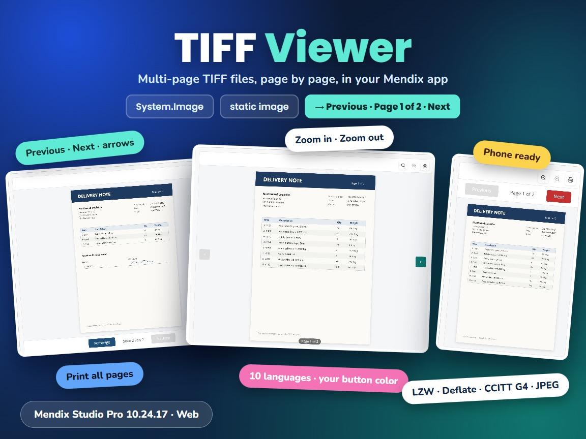

# TIFF Viewer

A Mendix pluggable widget that shows TIFF images (Tagged Image File Format) in the browser. It shows single and multi-page TIFF files one page at a time, with Previous/Next buttons, zoom and a print button that prints all pages.



## Documentation

- [TIFF Viewer 10.24.17.docx](docs/TIFF%20Viewer%2010.24.17.docx): install, upgrade, configuration, properties, examples, styling and limitations.
- [Marketplace documentation](docs/Marketplace%20Documentation%20-%20TIFF%20Viewer.md): the same in short form.

## Version 1.1.0 for Mendix Studio Pro 10.24.17

- Download `mxtechies.TiffViewer.mpk` from the release [Version1.1.0](https://github.com/bharathidas/TiffViewer/releases/tag/Version1.1.0) or from the root of this repository.
- The previous package (1.0.0, Mendix 10.18.3) is in release [V1.0.0](https://github.com/bharathidas/TiffViewer/releases/tag/V1.0.0).
- Copy it into the `widgets` folder of your app and press **F4** (App > Synchronize App Directory) in Studio Pro.
- Place **TIFF Viewer** in a data view of an entity that is (or specializes) System.Image.

## Properties

| Property | Type | Description |
| --- | --- | --- |
| TIFF image | Image (required) | The TIFF file: a dynamic image (System.Image or a specialization) or a static image. |
| Height | Text | CSS height such as `600px`, `80vh` or `30rem`. A number without a unit is read as pixels. Default 600px. |
| Page buttons | String attribute | `bottom` (default), `top` or `ltr` (arrows left and right of the page). |
| Button color | String attribute | CSS color of the page buttons. Default `#c53030`. |
| Language | String attribute | `en` (default), `de`, `fr`, `es`, `tr`, `ja`, `zh`, `ru`, `ar` or `hi`; `fr-FR` is read as `fr`. |
| Show zoom buttons | Boolean attribute | Not selected: shown. |
| Show print button | Boolean attribute | Not selected: shown. Print prints all pages of the file. |

The CSS classes `widget-tiffviewer`, `widget-tiffviewer-toolbar`, `widget-tiffviewer-tool`, `widget-tiffviewer-page`, `widget-tiffviewer-pager`, `widget-tiffviewer-page-button`, `widget-tiffviewer-arrow` and `widget-tiffviewer-error` can be used for styling.

## Changes in 1.1.0

See [the release notes](RELEASE-NOTES.md).

## Issues, suggestions and feature requests

https://github.com/bharathidas/TiffViewer/issues

## Source code and build

The widget source is in the [`tiffViewer`](tiffViewer) folder.

```
cd tiffViewer
npm install
npm run release
```

The package is created in `tiffViewer/dist/1.1.0/mxtechies.TiffViewer.mpk`. Node.js 16 or later is required.
